# Caminho das Pedras

**Gold junior in 52 weeks** · Oct 18, 2026 → Oct 17, 2027

The whole year in the order you learn it: the subject map, what each month covers, the monthly goals and the exact work for every week. Open it every Sunday to plan the week ahead.

- **Load:** 14h a week (2h every day) + HUB 25 min each weekday
- **Checkpoints:** Apr 17, 2027 (6 months) · Oct 17, 2027 (the goal)
- **Milestones:** Jansenbot live on May 22, 2027 · penssay launch by Sep 4, 2027
- **Live version with trackers:** [Caminho das Pedras](https://claude.ai/artifact/KFTaScYYXn8mx3Tv4XRu3N)

## Contents

1. [The map](#the-map)
2. [Month by month](#month-by-month)
3. [Monthly goals](#monthly-goals)
4. [The weekly blocks](#the-weekly-blocks)
5. [Week by week](#week-by-week)
6. [House rules](#house-rules)
7. [The goal](#the-goal)

## The map

Each subject builds on the ones before it.

```mermaid
flowchart LR
  A[1 · Java core<br/>Oct 18 – Nov 28] --> B[2 · Databases<br/>Nov 29 – Jan 16]
  B --> C[3 · Spring internals + JPA<br/>Jan 17 – Feb 13]
  C --> D[4 · Operating systems<br/>Feb 14 – Mar 6]
  D --> E[5 · Concurrency<br/>Mar 7 – Apr 3]
  E --> F[6 · Networks<br/>Apr 4 – Apr 24]
  F --> G[7 · Docker, CI/CD, deploy<br/>Apr 25 – May 22]
  G --> H[8 · Design + architecture<br/>May 23 – Jul 3]
  H --> I[9 · System design<br/>Jul 4 – Jul 31]
  I --> J[10 · Applied AI<br/>Aug 1 – Sep 18]
  J --> K[11 · Interview sprint<br/>Sep 19 – Oct 16]
  K --> Z((Gold junior<br/>Oct 17, 2027))
```

| # | Subject | When | Builds on | Topics |
|---|---|---|---|---|
| 1 | Java core | Oct 18 – Nov 28 · 6 wk | What you already use | Object contracts · collections and costs · generics · immutability, records, enums · exceptions, Optional · streams, JVM memory |
| 2 | Databases | Nov 29 – Jan 16 · 5 wk + holidays | Java core | SQL joins, aggregates, window functions · modeling · indexes, B-trees, EXPLAIN · transactions, isolation, MVCC · JDBC, pools, pagination |
| 3 | Spring internals and JPA | Jan 17 – Feb 13 · 4 wk | Java core, Databases | IoC and auto-configuration · proxies, AOP, @Transactional · request path, Spring Security · JPA, N+1, @Version |
| 4 | Operating systems | Feb 14 – Mar 6 · 3 wk | Java core (JVM memory) | Processes, syscalls, signals · scheduling, OS threads · virtual memory, paging · files, descriptors, I/O |
| 5 | Concurrency | Mar 7 – Apr 3 · 4 wk | OS, Java core, Databases | Races, JMM, happens-before · locks, deadlock · executors, CompletableFuture, virtual threads · DB locking, idempotency |
| 6 | Networks | Apr 4 – Apr 24 · 2 wk + checkpoint | OS (sockets, I/O) | TCP/IP, TCP vs UDP · DNS · HTTP/1.1, HTTP/2, REST · TLS, certificates |
| 7 | Docker, CI/CD and deploy | Apr 25 – May 22 · 4 wk | OS, Networks | Namespaces, cgroups, layers · Dockerfile, Compose · Git beyond basics · CI pipelines · VPS, reverse proxy, HTTPS, backups |
| 8 | Design and architecture | May 23 – Jul 3 · 6 wk | Java, Spring, code in production | SOLID · design patterns · refactoring · hexagonal · DDD-lite, test strategy · ADRs, C4 |
| 9 | System design | Jul 4 – Jul 31 · 4 wk | DB, Concurrency, Networks, Design | Scaling, estimation · caching with Redis · queues, outbox · replication, partitioning |
| 10 | Applied AI | Aug 1 – Sep 18 · 7 wk | Spring, DB (pgvector), System design | LLM basics, prompting · embeddings · RAG · evals · AI in production · tool calling, agents |
| 11 | Interview sprint | Sep 19 – Oct 16 · 4 wk | Everything | System design interviews · mock interviews in English · project stories · CV, applications |

## Month by month

A week belongs to the month its Wednesday falls in.

| Month | Fundamentals | LeetCode | Jansenbot and penssay | HUB · 25 min/day |
|---|---|---|---|---|
| Oct 2026 | Java core (W1–W2) | Arrays & Hashing | New repo, domain model, points rule, ranking | Literature review, questions for the professor |
| Nov 2026 | Java core (W3–W6), phase exam | Hashing, Two Pointers, Sliding Window | Event flow in plain Java | Literature review, equipment training |
| Dec 2026 | Databases (W7–W9), holidays (W10–W11) | Sliding Window, Stack | Postgres schema, Flyway, ranking in SQL | Training; collection starts, patient names removed first |
| Jan 2027 | Databases (W12–W13), Spring and JPA (W14–W15) | Binary Search, Linked List | Transactions, Testcontainers, Spring Boot, webhook | Collection: file readers |
| Feb 2027 | Spring and JPA (W16–W17), OS (W18–W19) | Trees | Validation, security, JPA, graceful shutdown | Collection; sync routine v1 starts |
| Mar 2027 | OS (W20), Concurrency (W21–W24) | Heap, Backtracking, Tries | Race fixes, scheduler, idempotent webhook | Collection ends; sync routine v1 |
| Apr 2027 | Networks (W25, W27), checkpoint (W26), Docker (W28) | Graphs | Timeouts, webhook auth, Dockerfile | Data analysis |
| May 2027 | Docker, CI/CD, deploy (W29–W31), Design (W32) | Advanced graphs, 1-D DP | Compose, CI, live for the band May 22 | Analysis; product testing |
| Jun 2027 | Design and architecture (W33–W37) | 1-D DP, 2-D DP, Greedy | Strategy, refactoring, hexagonal, ADRs | Product testing |
| Jul 2027 | System design (W38–W41) | Intervals, Bit manipulation | Stateless app, Redis cache, outbox | Write-up, innovation registration |
| Aug 2027 | Applied AI (W42–W45) | Mixed review, mocks | penssay rebuild (Thu + Sat) | Final report and SEMUNI (crunch) |
| Sep 2027 | Applied AI (W46–W48), Interview sprint (W49–W50) | Mock interviews | penssay launch by Sep 4, AI commands, CV | Final report and SEMUNI; ends Sep 30 |
| Oct 2027 | Interview sprint (W51–W52), goal Oct 17 | Mock interviews | Applications, year-2 plan | Done |

## Monthly goals

Seven goals, measured the same way every month. Fill them on the month's last Sunday, after the quiz.

**How a month is judged:** 6–7 goals hit = on track. 4–5 = at risk: the first week of next month goes to the gaps. 0–3 = off track: the plan shifts by one week. Targets sit at about 80% of the plan.

| Goal | Rule |
|---|---|
| Blocks done | ≥ 85% of planned blocks (holiday weeks = 2 blocks) |
| Month quiz | ≥ 8/10, no lookup (the phase exam counts in months that have one) |
| Explained with no lookup | All of the month's diagnostic questions, out loud in 2 min |
| Deliverables shipped | ≥ 80% of the month's list |
| LeetCode solved | The month's target |
| Solved alone | The month's % target, no hints |
| AI-written share of Jansenbot | At or under the month's ceiling, honest estimate |

### October 2026 · Weeks 1–2

**Write Java's core contracts by hand and start the new Jansenbot.**

| Goal | Target | Result |
|---|---|---|
| Blocks done | 12 of 14 | |
| Month quiz, or the phase exam if the month has one | 8/10 | |
| Explained with no lookup | all 4 | |
| Deliverables | 4 of 5 | |
| LeetCode solved | 5 | |
| Solved alone | 30% | |
| AI-written share | ≤ 50% | |

Explain with no lookup:
- [ ] **4.1a** Why HashMap lookup is O(1) and what breaks it
- [ ] **4.1b** ArrayList vs LinkedList in practice
- [ ] **4.2a** The equals/hashCode contract
- [ ] **4.2c** Stack vs heap: where objects and references live

Deliverables:
- [ ] Member with equals/hashCode and a test that breaks a HashSet
- [ ] SimpleHashMap with resize, tested
- [ ] DynamicArray and the ArrayList vs LinkedList timing
- [ ] Jansenbot repo with the domain model and points rule, tested
- [ ] Funcionário do Mês ranking with every tie-break

### November 2026 · Weeks 3–6

**Finish Java core and the whole Jansenbot domain in plain Java.**

| Goal | Target | Result |
|---|---|---|
| Blocks done | 24 of 28 | |
| Month quiz, or the phase exam if the month has one | 8/10 | |
| Explained with no lookup | all 3 | |
| Deliverables | 4 of 5 | |
| LeetCode solved | 8 | |
| Solved alone | 40% | |
| AI-written share | ≤ 50% | |

Explain with no lookup:
- [ ] **4.1f** Sort plus binary search vs sequential search
- [ ] **4.2b** Why String is immutable
- [ ] **4.2e** Checked vs unchecked exceptions

Deliverables:
- [ ] Generic InMemoryRepository
- [ ] TimeWindow record and EventType enum
- [ ] Domain exceptions and Optional, failure paths tested
- [ ] Loops rewritten as streams and back
- [ ] Jansenbot event flow green: confirm, silence, attentive window, CHEGUEI, reschedule, cancel

### December 2026 · Weeks 7–11

**Put Jansenbot on Postgres and read query plans with confidence.**

| Goal | Target | Result |
|---|---|---|
| Blocks done | 22 of 25 | |
| Month quiz, or the phase exam if the month has one | 8/10 | |
| Explained with no lookup | all 2 | |
| Deliverables | 4 of 5 | |
| LeetCode solved | 6 | |
| Solved alone | 40% | |
| AI-written share | ≤ 40% | |

Explain with no lookup:
- [ ] **4.5a** How a B-tree index speeds a query and when it hurts
- [ ] **4.5d** What EXPLAIN ANALYZE shows

Deliverables:
- [ ] pgexercises: joins, aggregates and window functions
- [ ] Library schema with migrations V1 to V3
- [ ] 1M-row index experiment, plans compared
- [ ] Jansenbot on Postgres with Flyway and JDBC
- [ ] Ranking with RANK() OVER, EXPLAIN ANALYZE before and after

### January 2027 · Weeks 12–15

**Master transactions and see how Spring works inside.**

| Goal | Target | Result |
|---|---|---|
| Blocks done | 24 of 28 | |
| Month quiz, or the phase exam if the month has one | 8/10 | |
| Explained with no lookup | all 4 | |
| Deliverables | 4 of 5 | |
| LeetCode solved | 10 | |
| Solved alone | 50% | |
| AI-written share | ≤ 40% | |

Explain with no lookup:
- [ ] **4.5b** ACID
- [ ] **4.5c** Isolation levels and their anomalies
- [ ] **4.4a** IoC and dependency injection
- [ ] **4.4b** Why @Transactional fails on self-invocation

Deliverables:
- [ ] Lost update reproduced and fixed in psql
- [ ] SQL injection exploited and fixed
- [ ] Tiny DI container with reflection
- [ ] JDK proxy and the self-invocation test
- [ ] Jansenbot: Testcontainers tests, Spring Boot wired, webhook endpoint

### February 2027 · Weeks 16–19

**Finish Spring and JPA, then start operating systems.**

| Goal | Target | Result |
|---|---|---|
| Blocks done | 24 of 28 | |
| Month quiz, or the phase exam if the month has one | 8/10 | |
| Explained with no lookup | all 3 | |
| Deliverables | 4 of 5 | |
| LeetCode solved | 10 | |
| Solved alone | 50% | |
| AI-written share | ≤ 35% | |

Explain with no lookup:
- [ ] **4.4c** The N+1 problem and its fixes
- [ ] **4.4d** The request path inside Spring
- [ ] **4.6a** Process vs thread

Deliverables:
- [ ] Filter and interceptor order logged, request path drawn
- [ ] N+1 reproduced and fixed by query count
- [ ] Graceful shutdown on SIGTERM
- [ ] Scheduler simulator with tests
- [ ] Jansenbot: validation, error handling, Spring Data JPA, ranking without N+1

### March 2027 · Weeks 20–24

**Understand memory and make Jansenbot safe under concurrency.**

| Goal | Target | Result |
|---|---|---|
| Blocks done | 30 of 35 | |
| Month quiz, or the phase exam if the month has one | 8/10 | |
| Explained with no lookup | all 5 | |
| Deliverables | 5 of 6 | |
| LeetCode solved | 11 | |
| Solved alone | 55% | |
| AI-written share | ≤ 30% | |

Explain with no lookup:
- [ ] **4.1c** When to use a heap
- [ ] **4.2d** Virtual threads
- [ ] **4.3a** Race conditions
- [ ] **4.3b** Optimistic vs pessimistic locking
- [ ] **4.3c** Deadlock and how to avoid it

Deliverables:
- [ ] OutOfMemoryError caused and heap dump read
- [ ] Counter fixed 3 ways, each proven by a test
- [ ] Deadlock found with jstack and fixed
- [ ] Fixed pool vs virtual threads measured
- [ ] Jansenbot: both races fixed, attentive-mode scheduler, idempotent webhook
- [ ] Marketplace @Version conflict test

### April 2027 · Weeks 25–28

**Pass the 6-month checkpoint and understand the network under your code.**

| Goal | Target | Result |
|---|---|---|
| Blocks done | 24 of 28 | |
| Month quiz plus the 6-month checkpoint | 8/10 | |
| Explained with no lookup | all 5 | |
| Deliverables | 4 of 5 | |
| LeetCode solved | 6 | |
| Solved alone | 60% | |
| AI-written share | ≤ 30% | |

Explain with no lookup:
- [ ] **4.1d** BFS vs DFS
- [ ] **4.6b** What happens when you open https://google.com
- [ ] **4.6c** TCP vs UDP
- [ ] **4.6d** What HTTPS adds
- [ ] **4.8a** Image vs container

Deliverables:
- [ ] TCP echo server and client
- [ ] Handshake watched in Wireshark
- [ ] HTTP request sent over a raw socket
- [ ] Shell in its own namespace with unshare
- [ ] Jansenbot: timeouts and retries, webhook auth, multi-stage Dockerfile

### May 2027 · Weeks 29–32

**Jansenbot live for the band, deployed by CI.**

| Goal | Target | Result |
|---|---|---|
| Blocks done | 24 of 28 | |
| Month quiz, or the phase exam if the month has one | 8/10 | |
| Explained with no lookup | all 3 | |
| Deliverables | 5 of 6 | |
| LeetCode solved | 10 | |
| Solved alone | 60% | |
| AI-written share | ≤ 30% | |

Explain with no lookup:
- [ ] **4.8b** What a CI pipeline must do before production
- [ ] **4.8c** How to put a Spring + Postgres API online
- [ ] **4.7b** A SOLID principle with a real example

Deliverables:
- [ ] Compose with healthcheck
- [ ] Bad commit found with git bisect
- [ ] CI blocks a failing merge
- [ ] Backup restored into a fresh database
- [ ] Jansenbot live: VPS, HTTPS, deploy on push, daily backup
- [ ] Two SOLID violations fixed in the old bot

### June 2027 · Weeks 33–37

**Turn Jansenbot into a well-designed codebase.**

| Goal | Target | Result |
|---|---|---|
| Blocks done | 30 of 35 | |
| Month quiz, or the phase exam if the month has one | 8/10 | |
| Explained with no lookup | all 3 | |
| Deliverables | 4 of 5 | |
| LeetCode solved | 12 | |
| Solved alone | 50% | |
| AI-written share | ≤ 30% | |

Explain with no lookup:
- [ ] **4.1e** Dynamic programming
- [ ] **4.7a** Unit vs integration tests
- [ ] **4.7c** Hexagonal architecture

Deliverables:
- [ ] 7 pattern examples with tests
- [ ] Gilded Rose refactored under tests
- [ ] Jansenbot hexagonal, with the console adapter
- [ ] Scoring as a Strategy
- [ ] 3 ADRs and C4 diagrams

### July 2027 · Weeks 38–41

**Design systems out loud and scale Jansenbot.**

| Goal | Target | Result |
|---|---|---|
| Blocks done | 24 of 28 | |
| Month quiz, or the phase exam if the month has one | 8/10 | |
| Explained with no lookup | all 3 | |
| Deliverables | 5 of 6 | |
| LeetCode solved | 9 | |
| Solved alone | 65% | |
| AI-written share | ≤ 30% | |

Explain with no lookup:
- [ ] **4.7d** The main risk of a Redis cache
- [ ] **SD1** Design a URL shortener out loud in 30 minutes
- [ ] **SD2** Design a rate limiter out loud in 30 minutes

Deliverables:
- [ ] Estimate for 10,000 bands
- [ ] Cache measured with and without
- [ ] RabbitMQ producer, consumer and outbox
- [ ] 2 recorded designs
- [ ] Jansenbot: stateless, Redis cache, outbox
- [ ] Design doc: Jansenbot for 1,000 bands

### August 2027 · Weeks 42–45

**Learn applied AI by rebuilding penssay.**

| Goal | Target | Result |
|---|---|---|
| Blocks done | 24 of 28 | |
| Month quiz, or the phase exam if the month has one | 8/10 | |
| Explained with no lookup | all 4 | |
| Deliverables | 5 of 6 | |
| LeetCode solved | 6 | |
| Solved alone | 65% | |
| AI-written share | ≤ 30% | |

Explain with no lookup:
- [ ] **4.9a** Tokens and context windows
- [ ] **4.9b** Embeddings
- [ ] **4.9c** The RAG pipeline
- [ ] **4.9e** How to know an AI system got better

Deliverables:
- [ ] Claude API client in Java with structured output
- [ ] pgvector nearest-neighbor demo
- [ ] Chunk sizes compared
- [ ] Eval run before and after a prompt change
- [ ] penssay: RAG grading per competência
- [ ] penssay: eval set, error per competência in the README

### September 2027 · Weeks 46–50

**penssay public, Jansenbot understands natural language, interview prep starts.**

| Goal | Target | Result |
|---|---|---|
| Blocks done | 30 of 35 | |
| Month quiz, or the phase exam if the month has one | 8/10 | |
| Explained with no lookup | all 2 | |
| Deliverables | 5 of 6 | |
| LeetCode solved | 5 | |
| Solved alone | 70% | |
| AI-written share | ≤ 30% | |

Explain with no lookup:
- [ ] **4.9d** Tool calling: who runs the tool
- [ ] **SD3** Design a notification system out loud

Deliverables:
- [ ] penssay public by Sep 4
- [ ] Prompt injection test and fixes
- [ ] Tool loop written by hand
- [ ] Jansenbot natural-language commands with a 30-message eval
- [ ] CV and LinkedIn rewritten
- [ ] 6 STAR stories told in English

### October 2027 · Weeks 51–52

**Hit the gold-junior bar.**

| Goal | Target | Result |
|---|---|---|
| Blocks done | 12 of 14 | |
| Mock interviews passed | 3/4 | |
| Explained with no lookup | all 1 | |
| Deliverables | 4 of 4 | |
| Interview problems solved | 4 | |
| Solved alone | 70% | |
| AI-written share | ≤ 30% | |

Explain with no lookup:
- [ ] **DX** Full diagnostic with no lookup: 3 or more in every area except front-end

Deliverables:
- [ ] 45-minute mock interview in English
- [ ] 5 applications sent
- [ ] Full diagnostic retaken
- [ ] Year-2 plan written

## The weekly blocks

| Day | Block | What |
|---|---|---|
| Sun | Fundamentals 2h | Read the week's chapters. Notes by hand. |
| Mon | Fundamentals 2h | Study the topics, start the lab. |
| Tue | LeetCode 2h | 2 new problems, 30 min each. |
| Wed | Fundamentals 2h | Finish the lab, explain it to an AI tutor. |
| Thu | Jansenbot 2h | The week's Jansenbot task, by hand. |
| Fri | LeetCode 1h + Blank page 1h | 1 new problem and reviews. Rewrite the lab from memory, then record 5 min explaining it in English. |
| Sat | Jansenbot 2h | Finish the task, tests green. |

HUB: 25 minutes before the block, Monday to Friday, outside the 14 hours.

## Week by week

### October 2026

> **HUB, 25 min/day:** literature review · write the questions for the professor: which event aligns the two clocks, what each machine exports

#### Week 1 · Oct 18 – 24 · Java core

**Object contracts, hashing and memory**

- **Topics:** The equals/hashCode contract · how HashMap works inside (buckets, load factor 0.75, a crowded bucket turns into a tree) · why a mutable key gets lost · stack vs heap
- **Read:** Effective Java Items 10, 11, 17
- **Lab:** Member with a correct equals/hashCode and a test that breaks a HashSet · your own SimpleHashMap with resize · a test that loses a mutable key
- **LeetCode:** #1 Two Sum · #217 Contains Duplicate · #242 Valid Anagram
- **Jansenbot:** New hand-written repo (Java 21 + JUnit, no Spring) · domain model Member, Event, Attendance · points rule test-first
- **Weekly doc:** [weeks/week-01.md](weeks/week-01.md)
- [ ] Week done

#### Week 2 · Oct 25 – 31 · Java core

**Collections and their costs**

- **Topics:** List, Set, Map and Deque implementations · Big-O of each operation · ArrayList growth and amortized O(1) · ArrayList vs LinkedList in practice · Comparable and Comparator
- **Read:** Effective Java Item 14 · javadocs of ArrayList, HashMap, TreeMap, ArrayDeque
- **Lab:** Your own DynamicArray with growth · time 100k inserts in ArrayList vs LinkedList and explain the result
- **LeetCode:** #49 Group Anagrams · #347 Top K Frequent Elements · #238 Product of Array Except Self
- **Jansenbot:** Funcionário do Mês ranking with every tie-break as a Comparator chain · one test per tie-break
- [ ] Week done

### November 2026

> **HUB, 25 min/day:** literature review and equipment training

#### Week 3 · Nov 1 – 7 · Java core

**Generics**

- **Topics:** Type parameters and bounded types · wildcards and PECS (? extends, ? super) · type erasure and its limits · generic methods
- **Read:** Effective Java Items 26–31
- **Lab:** A generic InMemoryRepository<T, ID> · a copy method that only compiles with the right wildcards
- **LeetCode:** #36 Valid Sudoku · #128 Longest Consecutive Sequence · review #49
- **Jansenbot:** Event flow in plain Java: only the admin marks events, members confirm sim/não, silence becomes “não vai” · generic in-memory repositories
- [ ] Week done

#### Week 4 · Nov 8 – 14 · Java core

**Immutability, records and enums**

- **Topics:** Immutable classes and defensive copies · records and compact constructors · enums with behavior · value objects
- **Read:** Effective Java Items 17, 34, 50
- **Lab:** A TimeWindow record that validates itself · an EventType enum that carries its points
- **LeetCode:** #125 Valid Palindrome · #167 Two Sum II · #15 3Sum
- **Jansenbot:** EventType carries the points · attentive window as an immutable value (30 min before until 3h after or EVENTO_ENCERRADO) · CHEGUEI accepted only inside it
- [ ] Week done

#### Week 5 · Nov 15 – 21 · Java core

**Exceptions and Optional**

- **Topics:** Checked vs unchecked · designing domain exceptions · try-with-resources · Optional instead of null
- **Read:** Effective Java Items 55, 69–77
- **Lab:** A domain exception hierarchy · null returns replaced with Optional · tests for every failure path
- **LeetCode:** #11 Container With Most Water · #42 Trapping Rain Water · review #15
- **Jansenbot:** Rescheduling resets every confirmation · cancellation · a non-admin trying to mark an event fails with a domain exception
- [ ] Week done

#### Week 6 · Nov 22 – 28 · Java core · `Phase exam`

**Streams, lambdas and the JVM**

- **Topics:** Lambdas and method references · collectors: groupingBy, partitioningBy, toMap · JVM memory areas · garbage collection and generations at a high level
- **Read:** Effective Java Items 42–48
- **Lab:** Rewrite 5 loops as streams and 5 streams as loops · draw the JVM memory of one request · Java core quiz (8/10 to pass)
- **LeetCode:** #121 Best Time to Buy and Sell Stock · #3 Longest Substring Without Repeating Characters · #424 Longest Repeating Character Replacement
- **Jansenbot:** Monthly report built with collectors · result hidden until day 1 of the next month · the whole domain green in tests
- [ ] Week done

### December 2026

> **HUB, 25 min/day:** equipment training · data collection starts: remove patient names before anything else

#### Week 7 · Nov 29 – Dec 5 · Databases

**SQL beyond the basics**

- **Topics:** Inner, left and anti joins · GROUP BY and HAVING · subqueries vs CTEs · window functions: ROW_NUMBER, RANK, SUM OVER
- **Read:** PostgreSQL docs: Tutorial (Advanced Features) and Window Functions
- **Lab:** pgexercises.com: the joins, aggregates and window function sections
- **LeetCode:** #567 Permutation in String · #76 Minimum Window Substring · review #3
- **Jansenbot:** Postgres schema for members, events and attendance · ER diagram on paper first
- [ ] Week done

#### Week 8 · Dec 6 – 12 · Databases

**Data modeling**

- **Topics:** Normal forms 1NF–3NF and when to denormalize · keys and constraints: PK, FK, UNIQUE, CHECK · modeling N:N · migrations
- **Read:** PostgreSQL docs: Data Definition (constraints) · Flyway docs: getting started
- **Lab:** Model a small library system and write its migrations V1 to V3
- **LeetCode:** #20 Valid Parentheses · #155 Min Stack · #150 Evaluate Reverse Polish Notation
- **Jansenbot:** Flyway migrations · JDBC repositories for Member and Event (plain JDBC, no JPA)
- [ ] Week done

#### Week 9 · Dec 13 – 19 · Databases

**Indexes and query plans**

- **Topics:** How a B-tree index works · composite indexes and column order · when an index hurts · reading EXPLAIN and EXPLAIN ANALYZE
- **Read:** Use The Index, Luke! chapters 1–3
- **Lab:** Load 1M rows, time a query, add the right index, compare the two plans
- **LeetCode:** #22 Generate Parentheses · #739 Daily Temperatures · #853 Car Fleet
- **Jansenbot:** Ranking query in SQL with RANK() OVER · an index for it · EXPLAIN ANALYZE before and after
- [ ] Week done

#### Week 10 · Dec 20 – 26 · Holidays · `Holiday`

**Christmas week**

- **Topics:** No new topic
- **Read:** None
- **Lab:** Optional: finish anything left from weeks 7–9
- **LeetCode:** Reviews only: every problem you didn't solve alone
- **Jansenbot:** Optional catch-up
- **Blocks planned:** 2
- [ ] Week done

#### Week 11 · Dec 27 – Jan 2 · Holidays · `Holiday`

**New Year week**

- **Topics:** No new topic
- **Read:** None
- **Lab:** Blank page: explain indexes and window functions out loud, no notes
- **LeetCode:** Reviews only
- **Jansenbot:** Optional catch-up
- **Blocks planned:** 2
- [ ] Week done

### January 2027

> **HUB, 25 min/day:** data collection: file readers for EMG (EDF/CSV) and ultrasound (DICOM/AVI)

#### Week 12 · Jan 3 – 9 · Databases

**Transactions and isolation**

- **Topics:** ACID · isolation levels: read committed, repeatable read, serializable · anomalies: dirty read, non-repeatable read, phantom, lost update · MVCC in Postgres
- **Read:** PostgreSQL docs: Concurrency Control chapter
- **Lab:** Two psql sessions: reproduce a lost update, then fix it with SELECT … FOR UPDATE and with serializable
- **LeetCode:** #704 Binary Search · #74 Search a 2D Matrix · #875 Koko Eating Bananas
- **Jansenbot:** Transaction boundaries for confirmations and arrivals · integration tests with Testcontainers
- [ ] Week done

#### Week 13 · Jan 10 – 16 · Databases · `Phase exam`

**Databases from Java**

- **Topics:** JDBC and prepared statements · SQL injection · connection pooling with HikariCP · offset vs keyset pagination
- **Read:** HikariCP wiki: About Pool Sizing · PostgreSQL JDBC driver docs
- **Lab:** Exploit a string-built query with SQL injection, then fix it · keyset pagination over 1M rows · databases quiz (8/10)
- **LeetCode:** #153 Find Minimum in Rotated Sorted Array · #33 Search in Rotated Sorted Array · #981 Time Based Key-Value Store
- **Jansenbot:** HikariCP pool · keyset pagination for attendance history · every repository covered by integration tests
- [ ] Week done

#### Week 14 · Jan 17 – 23 · Spring and JPA

**The IoC container**

- **Topics:** ApplicationContext and bean definitions · scopes and lifecycle · constructor injection · how Spring Boot auto-configuration picks beans (@Conditional)
- **Read:** Spring Framework reference: The IoC Container · Spring Boot reference: Auto-configuration
- **Lab:** Build a tiny DI container with reflection: register classes, resolve them by constructor
- **LeetCode:** #206 Reverse Linked List · #21 Merge Two Sorted Lists · #143 Reorder List
- **Jansenbot:** Spring Boot comes in: wire the domain services · admin number and settings from configuration properties
- [ ] Week done

#### Week 15 · Jan 24 – 30 · Spring and JPA

**Proxies, AOP and transactions**

- **Topics:** JDK dynamic proxies vs CGLIB · how @Transactional, @Async and @Cacheable work · the self-invocation trap · propagation and rollback rules
- **Read:** Spring Framework reference: AOP and Declarative Transaction Management
- **Lab:** A JDK dynamic proxy that logs timing · a test that reproduces the self-invocation bug
- **LeetCode:** #19 Remove Nth Node From End of List · #141 Linked List Cycle · #2 Add Two Numbers
- **Jansenbot:** Transactional services · webhook endpoint for the Evolution API
- [ ] Week done

### February 2027

> **HUB, 25 min/day:** data collection · sync routine v1 starts

#### Week 16 · Jan 31 – Feb 6 · Spring and JPA

**The request path and Spring Security**

- **Topics:** Servlet container and filter chain · DispatcherServlet, handler mapping, message converters · validation and @ControllerAdvice · SecurityFilterChain and where a JWT filter sits
- **Read:** Spring Framework reference: DispatcherServlet · Spring Security reference: Architecture
- **Lab:** A custom Filter and a HandlerInterceptor that log the order they run in · draw the full request path
- **LeetCode:** #226 Invert Binary Tree · #104 Maximum Depth of Binary Tree · #100 Same Tree
- **Jansenbot:** Payload validation · global error handling · admin endpoints protected
- [ ] Week done

#### Week 17 · Feb 7 – 13 · Spring and JPA · `Phase exam` `Carnival`

**JPA and Hibernate**

- **Topics:** Entity states and the persistence context · dirty checking and flush · LAZY vs EAGER · N+1 and JOIN FETCH or @EntityGraph · @Version
- **Read:** Hibernate ORM user guide: persistence context and fetching
- **Lab:** Reproduce an N+1, count the queries, fix it · Spring quiz (8/10)
- **LeetCode:** #572 Subtree of Another Tree · #543 Diameter of Binary Tree · #110 Balanced Binary Tree
- **Jansenbot:** Repositories move to Spring Data JPA · ranking without N+1, checked by query count
- **Note:** Carnival is Monday and Tuesday: move Monday's block to another day.
- [ ] Week done

#### Week 18 · Feb 14 – 20 · Operating systems

**Processes**

- **Topics:** Program vs process · system calls, fork and exec · process states and context switches · signals: SIGTERM vs SIGKILL · ps, top and kill on Linux
- **Read:** OSTEP chapters 4–6
- **Lab:** On WSL: run your Java app, inspect it with ps, top and jcmd, send SIGTERM and handle it with a shutdown hook
- **LeetCode:** #102 Binary Tree Level Order Traversal · #199 Binary Tree Right Side View · #235 Lowest Common Ancestor of a BST
- **Jansenbot:** Graceful shutdown: pending messages finish before exit · the bot runs on WSL as a process
- [ ] Week done

#### Week 19 · Feb 21 – 27 · Operating systems

**Scheduling and OS threads**

- **Topics:** FIFO, SJF, round robin, MLFQ · kernel threads vs user threads · what a JVM thread is to the OS
- **Read:** OSTEP chapters 7, 8 and 26
- **Lab:** A round robin vs FIFO simulator in Java that computes average turnaround time, with tests
- **LeetCode:** #98 Validate Binary Search Tree · #230 Kth Smallest Element in a BST · #1448 Count Good Nodes in Binary Tree
- **Jansenbot:** Design on paper how the timed jobs will run: cron vs in-app scheduler · first ADR draft
- [ ] Week done

### March 2027

> **HUB, 25 min/day:** collection ends · sync routine v1 on real data

#### Week 20 · Feb 28 – Mar 6 · Operating systems · `Phase exam`

**Memory and I/O**

- **Topics:** Address spaces and virtual memory · paging and the TLB at a high level · the JVM heap inside the process · file descriptors, buffering, blocking vs non-blocking I/O
- **Read:** OSTEP chapters 13, 15, 18, 36, 39
- **Lab:** Cause an OutOfMemoryError on purpose and read the heap dump · read a big file buffered vs unbuffered and time it · OS quiz (8/10)
- **LeetCode:** #703 Kth Largest Element in a Stream · #1046 Last Stone Weight · #973 K Closest Points to Origin
- **Jansenbot:** Structured logs to file with rotation · JVM memory limits set
- [ ] Week done

#### Week 21 · Mar 7 – 13 · Concurrency

**Thread safety**

- **Topics:** Race conditions and atomicity · visibility and the Java Memory Model · happens-before · volatile and synchronized
- **Read:** Java Concurrency in Practice chapters 1–3
- **Lab:** A counter shared by 8 threads that loses updates · fix it with synchronized, AtomicInteger and LongAdder, each proven by a test
- **LeetCode:** #215 Kth Largest Element in an Array · #621 Task Scheduler · #355 Design Twitter
- **Jansenbot:** List every piece of shared mutable state in the bot
- [ ] Week done

#### Week 22 · Mar 14 – 20 · Concurrency

**Locks and coordination**

- **Topics:** ReentrantLock and ReadWriteLock · condition variables and semaphores · CountDownLatch · deadlock, livelock, starvation · lock ordering
- **Read:** Java Concurrency in Practice chapters 5 and 10 · OSTEP chapters 28, 30–32
- **Lab:** Cause a deadlock with two locks, find it with jstack, fix it with lock ordering · a bounded producer-consumer buffer
- **LeetCode:** #78 Subsets · #39 Combination Sum · #46 Permutations
- **Jansenbot:** Race 1: two CHEGUEI at the same moment · a test that reproduces it, then the fix
- [ ] Week done

#### Week 23 · Mar 21 – 27 · Concurrency

**Executors, async and virtual threads**

- **Topics:** Thread pools and sizing · ExecutorService and ScheduledExecutorService · CompletableFuture · virtual threads and when they help
- **Read:** Java Concurrency in Practice chapters 6 and 8 · CompletableFuture javadoc · JEP 444 (virtual threads)
- **Lab:** Simulate 1,000 I/O calls with a fixed pool vs virtual threads and measure
- **LeetCode:** #90 Subsets II · #40 Combination Sum II · #79 Word Search
- **Jansenbot:** Attentive mode and the 20-second spaced messages on a ScheduledExecutorService · virtual threads for outbound HTTP calls
- [ ] Week done

#### Week 24 · Mar 28 – Apr 3 · Concurrency · `Phase exam`

**Concurrency in the database**

- **Topics:** Optimistic (@Version) vs pessimistic (SELECT … FOR UPDATE) locking · idempotency keys · at-least-once delivery · retries with backoff
- **Read:** Designing Data-Intensive Applications (1st ed.) chapter 7, first half · Spring Data JPA reference: locking
- **Lab:** Two threads update the same row: watch the optimistic lock fail and retry · concurrency quiz (8/10)
- **LeetCode:** #208 Implement Trie · #211 Design Add and Search Words Data Structure · review #79
- **Jansenbot:** Idempotent webhook: the same message twice has one effect · race 2: admin reschedules while confirmations arrive · marketplace: a test that proves the @Version conflict
- [ ] Week done

### April 2027

> **HUB, 25 min/day:** data analysis

#### Week 25 · Apr 4 – 10 · Networks

**Layers, TCP, UDP and DNS**

- **Topics:** TCP/IP layers · IP addresses and ports · TCP handshake, flow and congestion control · UDP and where it fits · DNS resolution
- **Read:** High Performance Browser Networking chapters 1–3 · Cloudflare Learning Center: What is DNS?
- **Lab:** A TCP echo server and client in Java · watch the handshake in Wireshark · trace a domain with dig
- **LeetCode:** #200 Number of Islands · #695 Max Area of Island · #133 Clone Graph
- **Jansenbot:** Connect and read timeouts plus retries when calling the Evolution API and the Claude API
- [ ] Week done

#### Week 26 · Apr 11 – 17 · Checkpoint · `Checkpoint`

**6-month checkpoint**

- **Topics:** Retake diagnostic sections 4.1 to 4.6 with no lookup · target 2.5 or more in every area studied so far
- **Read:** Your notes and blank pages from weeks 1–25
- **Lab:** Fill the gaps the retake shows, one gap per block
- **LeetCode:** 1 mock interview · reviews of everything you didn't solve alone
- **Jansenbot:** Catch-up: finish whatever slipped
- [ ] Week done

#### Week 27 · Apr 18 – 24 · Networks · `Phase exam`

**HTTP and TLS**

- **Topics:** HTTP/1.1 methods, status codes, headers, caching, keep-alive · HTTP/2 multiplexing · REST design · TLS handshake and certificate chains · CORS
- **Read:** High Performance Browser Networking chapters 4, 9, 11, 12
- **Lab:** Send an HTTP request by hand over a raw socket · read a certificate chain with openssl s_client · networks quiz (8/10)
- **LeetCode:** #994 Rotting Oranges · #207 Course Schedule · #210 Course Schedule II
- **Jansenbot:** Authenticate webhook calls with a shared secret · correct status codes on every endpoint
- [ ] Week done

#### Week 28 · Apr 25 – May 1 · Docker, CI/CD, deploy

**Containers from the inside**

- **Topics:** Namespaces and cgroups · image layers · image vs container · Dockerfile instructions, multi-stage builds, layer caching
- **Read:** Docker docs: Building images and Multi-stage builds
- **Lab:** Run a shell in its own namespace with unshare on WSL · build the Jansenbot image single-stage vs multi-stage and compare sizes
- **LeetCode:** #684 Redundant Connection · #127 Word Ladder · review #207
- **Jansenbot:** Multi-stage Dockerfile
- [ ] Week done

### May 2027

> **HUB, 25 min/day:** data analysis · product testing

#### Week 29 · May 2 – 8 · Docker, CI/CD, deploy

**Compose and Git beyond the basics**

- **Topics:** Compose networks, volumes, healthchecks · env files and secrets · rebase, interactive rebase, conflict resolution, bisect
- **Read:** Docker docs: Compose · Pro Git chapters 3 and 7
- **Lab:** Compose with app + Postgres + healthcheck · break a commit on purpose and find it with git bisect
- **LeetCode:** #743 Network Delay Time · #1584 Min Cost to Connect All Points · #787 Cheapest Flights Within K Stops
- **Jansenbot:** Compose for app + Postgres · one PR per feature, with rebased history
- [ ] Week done

#### Week 30 · May 9 – 15 · Docker, CI/CD, deploy

**CI/CD**

- **Topics:** Pipeline stages: build, test, static analysis, image, push · GitHub Actions workflows, caching, secrets · branch protection · trunk-based development
- **Read:** GitHub Actions docs: Understanding GitHub Actions, Building and testing Java with Maven
- **Lab:** Make a test fail on purpose and watch the pipeline block the merge
- **LeetCode:** #70 Climbing Stairs · #746 Min Cost Climbing Stairs · #198 House Robber
- **Jansenbot:** Pipeline: build, unit and Testcontainers tests, image pushed to GHCR
- [ ] Week done

#### Week 31 · May 16 – 22 · Docker, CI/CD, deploy · `Live` `Phase exam`

**Deploy to a real server**

- **Topics:** Linux server basics: SSH keys, users, firewall · domain and DNS records · reverse proxy with automatic HTTPS (Caddy) · backups with pg_dump · healthchecks and uptime monitoring
- **Read:** Caddy docs: reverse proxy quick-start · PostgreSQL docs: pg_dump
- **Lab:** Restore a backup into a fresh database to prove it works · deploy quiz (8/10)
- **LeetCode:** #213 House Robber II · #5 Longest Palindromic Substring · #647 Palindromic Substrings
- **Jansenbot:** Live for the band: VPS, domain, HTTPS, deploy on every push to main, daily backup
- [ ] Week done

#### Week 32 · May 23 – 29 · Design and architecture

**Cohesion, coupling and SOLID**

- **Topics:** Deep vs shallow modules · cohesion and coupling · SOLID with real examples · composition over inheritance
- **Read:** A Philosophy of Software Design chapters 1–6 · Effective Java Item 18
- **Lab:** List every SOLID violation in one class of the old vibecoded bot and fix two
- **LeetCode:** #91 Decode Ways · #322 Coin Change · #152 Maximum Product Subarray
- **Jansenbot:** Production week: fix what the band reports · aim for 2 weeks with no manual fixes
- [ ] Week done

### June 2027

> **HUB, 25 min/day:** product testing

#### Week 33 · May 30 – Jun 5 · Design and architecture

**Design patterns that matter**

- **Topics:** Strategy, Factory, Builder, Adapter, Decorator, Observer, Template Method · where Spring uses each one
- **Read:** Head First Design Patterns, 2nd ed.: the chapters on those patterns
- **Lab:** Each pattern in a 30-line example with a test · find 3 of them in Spring's source
- **LeetCode:** #139 Word Break · #300 Longest Increasing Subsequence · #416 Partition Equal Subset Sum
- **Jansenbot:** Points per event type become a Strategy · notifications go through domain events (Observer)
- [ ] Week done

#### Week 34 · Jun 6 – 12 · Design and architecture

**Refactoring**

- **Topics:** Code smells · characterization tests before refactoring · Extract Function, Replace Conditional with Polymorphism, Introduce Parameter Object
- **Read:** Refactoring, 2nd ed., chapters 1–3, with the catalog as reference
- **Lab:** The Gilded Rose kata: characterization tests first, then refactor
- **LeetCode:** #62 Unique Paths · #1143 Longest Common Subsequence · #309 Best Time to Buy and Sell Stock with Cooldown
- **Jansenbot:** Refactor the worst module, characterization tests first
- [ ] Week done

#### Week 35 · Jun 13 – 19 · Design and architecture

**Hexagonal architecture**

- **Topics:** Ports and adapters · the dependency rule · use cases as the application layer · mapping between layers
- **Read:** Get Your Hands Dirty on Clean Architecture, 2nd ed., first half
- **Lab:** Draw Jansenbot's hexagon: domain, ports, adapters
- **LeetCode:** #518 Coin Change II · #494 Target Sum · #72 Edit Distance
- **Jansenbot:** Refactor to hexagonal: MessagingPort (WhatsApp), LlmPort, persistence ports
- [ ] Week done

#### Week 36 · Jun 20 – 26 · Design and architecture

**DDD-lite and test strategy**

- **Topics:** Entities, value objects, aggregates and invariants · domain events · the test pyramid · stubs, mocks and fakes: what to mock and what not
- **Read:** Get Your Hands Dirty on Clean Architecture, second half
- **Lab:** A console adapter that drives the bot from tests
- **LeetCode:** #53 Maximum Subarray · #55 Jump Game · #45 Jump Game II
- **Jansenbot:** Swap WhatsApp for the console adapter without touching the domain
- [ ] Week done

#### Week 37 · Jun 27 – Jul 3 · Design and architecture · `Phase exam`

**Decisions and documentation**

- **Topics:** Architecture Decision Records · C4 diagrams: context, container, component · a README that explains decisions
- **Read:** adr.github.io · c4model.com
- **Lab:** Design quiz (8/10)
- **LeetCode:** #134 Gas Station · #763 Partition Labels · #678 Valid Parenthesis String
- **Jansenbot:** 3 ADRs and C4 diagrams in the repo
- [ ] Week done

### July 2027

> **HUB, 25 min/day:** write-up and innovation registration

#### Week 38 · Jul 4 – 10 · System design

**Scaling and estimation**

- **Topics:** Vertical vs horizontal scaling · load balancers and stateless services · latency numbers · back-of-the-envelope estimation
- **Read:** Designing Data-Intensive Applications (1st ed.) chapter 1 · System Design Interview vol. 1 chapters 1–2
- **Lab:** Estimate requests per second and storage for Jansenbot serving 10,000 bands
- **LeetCode:** #57 Insert Interval · #56 Merge Intervals · #435 Non-overlapping Intervals
- **Jansenbot:** Make the app stateless: nothing in memory that breaks with 2 instances
- **Note:** From this week through week 41, use the last 30 minutes of Saturday to collect graded ENEM essays (with competência scores) for penssay's eval set. August depends on that data.
- [ ] Week done

#### Week 39 · Jul 11 – 17 · System design

**Caching**

- **Topics:** Cache-aside and write-through · TTL and invalidation · cache stampede · Redis data types
- **Read:** Redis docs: data types and key expiration
- **Lab:** Measure the ranking endpoint with and without the cache
- **LeetCode:** #136 Single Number · #191 Number of 1 Bits · #338 Counting Bits
- **Jansenbot:** Redis cache for the monthly ranking, invalidated on every new attendance
- [ ] Week done

#### Week 40 · Jul 18 – 24 · System design

**Queues and async messaging**

- **Topics:** Queues vs pub/sub · at-least-once delivery and idempotent consumers · the outbox pattern · RabbitMQ basics
- **Read:** RabbitMQ tutorials 1–3 · Designing Data-Intensive Applications (1st ed.) chapter 11, first part
- **Lab:** Producer and consumer with RabbitMQ in Compose · an outbox table with a poller
- **LeetCode:** #268 Missing Number · #371 Sum of Two Integers · #48 Rotate Image
- **Jansenbot:** Outgoing WhatsApp messages go through an outbox, safe to retry · rate limit on sends
- [ ] Week done

#### Week 41 · Jul 25 – 31 · System design · `Phase exam`

**Data at scale and design interviews**

- **Topics:** Replication and lag · partitioning · consistency trade-offs · the interview framework: requirements, estimation, high level, deep dive
- **Read:** Designing Data-Intensive Applications (1st ed.) chapters 5–6 · System Design Interview vol. 1 chapters 3–4
- **Lab:** Design out loud, recorded: a URL shortener and a rate limiter · system design quiz (8/10)
- **LeetCode:** 2 mixed mediums + reviews · 1 mock interview
- **Jansenbot:** Design doc: Jansenbot for 1,000 bands
- [ ] Week done

### August 2027

> **HUB, 25 min/day:** final report and SEMUNI (crunch: borrows the Friday LeetCode hour)

#### Week 42 · Aug 1 – 7 · Applied AI

**LLM fundamentals**

- **Topics:** Tokens and context windows · sampling and temperature · prompting: structure, examples, structured output · cost and latency
- **Read:** AI Engineering (Chip Huyen) chapters 1, 2 and 5
- **Lab:** A Java client for the Claude API with structured JSON output and token counting
- **LeetCode:** 2 mixed mediums + reviews
- **Projects:** penssay rebuild starts on Thursday and Saturday until launch: new repo, grading prompt per ENEM competência
- [ ] Week done

#### Week 43 · Aug 8 – 14 · Applied AI

**Embeddings and vector search**

- **Topics:** What an embedding is · cosine similarity · vector indexes (HNSW) at a high level · pgvector
- **Read:** pgvector README · AI Engineering chapter 6, the retrieval part
- **Lab:** Embed 200 essay excerpts into pgvector and query the nearest ones
- **LeetCode:** 2 mixed mediums + reviews · 1 mock interview
- **Projects:** penssay: nota-1000 essays and the competência rubric stored in pgvector
- [ ] Week done

#### Week 44 · Aug 15 – 21 · Applied AI

**RAG**

- **Topics:** Chunking · retrieval and reranking · building the context · how RAG fails
- **Read:** AI Engineering chapter 6
- **Lab:** Compare 3 chunk sizes on the same 20 questions
- **LeetCode:** 2 mixed mediums + reviews
- **Projects:** penssay: RAG inside the grading flow, one score per competência
- [ ] Week done

#### Week 45 · Aug 22 – 28 · Applied AI

**Evals**

- **Topics:** Eval sets and metrics · LLM-as-judge and its pitfalls · regression tests for prompts
- **Read:** AI Engineering chapters 3–4
- **Lab:** Run the eval before and after one prompt change and record the difference
- **LeetCode:** 2 mixed mediums + reviews · 1 mock interview
- **Projects:** penssay: eval set of essays with real grades · error per competência in the README · photo of the handwritten draft turned into text
- [ ] Week done

### September 2027

> **HUB, 25 min/day:** final report and SEMUNI · the scholarship ends Sep 30

#### Week 46 · Aug 29 – Sep 4 · Applied AI · `Launch`

**AI in production**

- **Topics:** Prompt injection and guardrails · personal data in prompts · cost control and caching · logging and tracing LLM calls
- **Read:** AI Engineering chapter 5 (defensive prompt engineering) and chapter 10
- **Lab:** Attack your own app with prompt injection and fix what gets through
- **LeetCode:** 2 mixed mediums + reviews
- **Projects:** penssay public launch by Sep 4 · share it with students · watch the logs
- [ ] Week done

#### Week 47 · Sep 5 – 11 · Applied AI

**Tool calling and agents**

- **Topics:** The tool-use loop: the model asks, your code runs the tool · agent loops · when not to use an agent
- **Read:** Anthropic docs: tool use · AI Engineering chapter 6, the agents part
- **Lab:** A tool loop written by hand with 2 tools
- **LeetCode:** 2 mixed mediums + reviews · 1 mock interview
- **Jansenbot:** Admin commands in natural language (“marca ensaio sábado às 15h”) become tool calls · start with 3 commands
- [ ] Week done

#### Week 48 · Sep 12 – 18 · Applied AI · `Phase exam`

**Reliable agents**

- **Topics:** Evaluating tool choice · confirmation before actions · limits, timeouts and failure handling
- **Read:** Anthropic: Building effective agents
- **Lab:** AI quiz (8/10)
- **LeetCode:** 2 mixed mediums + reviews
- **Jansenbot:** 30-message eval set for the commands · penssay: fix what students broke
- [ ] Week done

#### Week 49 · Sep 19 – 25 · Interview sprint

**System design interviews**

- **Topics:** The framework end to end · URL shortener · notification system
- **Read:** System Design Interview vol. 1 chapters 8 and 10
- **Lab:** 2 designs out loud, recorded, 45 minutes each
- **LeetCode:** 2 mock interviews, one in English
- **Career:** CV and LinkedIn rewritten around Jansenbot, penssay and the HUB project
- [ ] Week done

#### Week 50 · Sep 26 – Oct 2 · Interview sprint

**Stories from your projects**

- **Topics:** STAR stories from your projects · explaining a technical decision · chat system design
- **Read:** System Design Interview vol. 1 chapter 12
- **Lab:** Write 6 STAR stories and tell each one in English in 2 minutes
- **LeetCode:** 2 mock interviews
- **Career:** Maintenance · project READMEs polished
- [ ] Week done

### October 2027

> **HUB, 25 min/day:** done

#### Week 51 · Oct 3 – 9 · Interview sprint

**Java and Spring deep-dive questions**

- **Topics:** Every diagnostic question answered at depth · follow-ups on the JVM, concurrency and Spring internals
- **Read:** Your notes from the year
- **Lab:** A 45-minute mock technical interview in English
- **LeetCode:** 2 mock interviews
- **Career:** Start applying: 5 applications
- [ ] Week done

#### Week 52 · Oct 10 – 16 · Interview sprint · `Goal`

**Final check**

- **Topics:** Retake the full diagnostic · check every item of the gold-junior bar
- **Read:** None
- **Lab:** Full diagnostic with no lookup: 3 or more in every area except front-end
- **LeetCode:** 1 mock interview + final review
- **Career:** Plan year 2 toward pleno
- [ ] Week done

## House rules

1. **AI in learning mode.** In study blocks, AI explains and corrects your explanations; it never writes the code. In Jansenbot, the week's topic is written by hand.
2. **LeetCode method.** 30 minutes with no help. If stuck, read the solution, close it, rewrite from scratch. Review on day 3 and day 10. Log every problem in `leetcode/TRACKER.md`.
3. **Phase exam.** Weeks tagged `Phase exam` end a subject with a 10-question quiz, no lookup. 8 or more and you move on. Under 8, the next week repeats the gaps and the plan shifts by a week. In a month with a phase exam, it also counts as the month quiz.
4. **Missed blocks.** A missed block moves to another day that week. A lost week shifts the plan by one week. No subject is skipped.
5. **FOMO.** New topics go to a parking-lot file and wait until the current subject ends.
6. **HUB.** 25 minutes a weekday, outside the 14 hours. Only during the Aug–Sep 2027 crunch does it borrow the Friday LeetCode hour.
7. **Front-end.** When the internship starts asking for React and TypeScript, it takes the Thursday Jansenbot block until it settles. Jansenbot's milestones slide by the same number of weeks.
8. **University exams.** A UnB exam week becomes a light week, like the holidays: LeetCode reviews and the blank page only. The plan shifts by one week.
9. **Recovery.** The holiday weeks and the checkpoint week are your rest. Keep them light. Sleep never pays for a missed block.

## The goal

**Gold junior on Oct 17, 2027:**

- Ships a feature alone: design, code, tests, deploy
- 3 out of 4 in every diagnostic area, no lookup
- About 70% of LeetCode mediums in 30 minutes
- Jansenbot and penssay in production with real users
- Finds what's wrong in AI-written code
- Holds a 45-minute interview in English

Pleno is the next step, realistic around Oct 2028.
